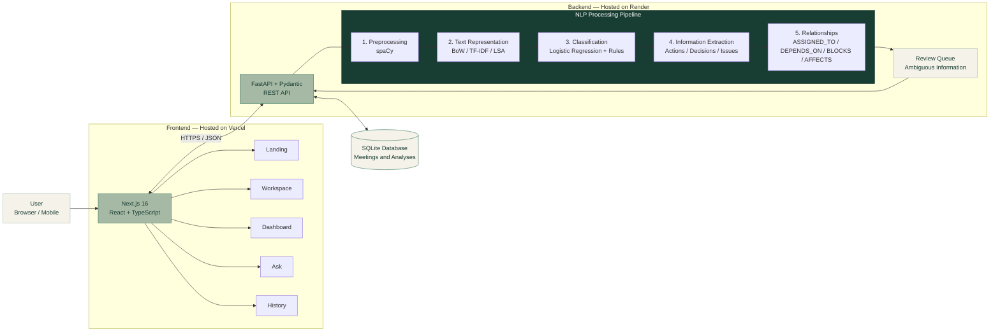

# InsightMeet — NLP-Based Meeting Insight Extraction

<p align="center">
  <strong>Every meeting has a story. Find what matters.</strong>
  <br/>
  Transform messy meeting conversations into structured, traceable, and actionable intelligence.
  <br/><br/>
  <a href="https://insight-meet-beta.vercel.app/">Live Demo</a> ·
  <a href="#features">Features</a> ·
  <a href="#architecture">Architecture</a> ·
  <a href="#installation">Installation</a>
</p>

<p align="center">
  
  
  
  
  
  
  
  
</p>

---

## Overview

**InsightMeet** is an NLP-powered meeting intelligence system that transforms unstructured meeting transcripts into meaningful and actionable information.

Instead of manually reviewing lengthy conversations, users can upload or paste meeting transcripts and automatically extract:

- Action items and responsible persons.
- Decisions and suggestions.
- Issues and blockers.
- Deadlines and deadline revisions.
- Participants and named entities.
- Relationships and task dependencies.
- Meeting summaries and key discussion topics.

Unlike a basic meeting summarizer, InsightMeet focuses on **evidence-backed information extraction**. Every extracted insight retains its original source sentence and character position, allowing users to verify where the information came from.

The application uses classical machine learning, NLP techniques, and rule-based extraction. It runs on CPU without requiring paid AI APIs or a GPU.

**Live Application:** https://insight-meet-beta.vercel.app/

## Problem Statement

Meetings are an essential part of academic, professional, and collaborative environments. However, important information is often buried in lengthy and informal conversations.

Meeting transcripts may contain:

- Inconsistent capitalization and missing punctuation.
- Repeated discussions and corrections.
- Informal language and incomplete sentences.
- Tentative commitments and suggestions.
- Changing deadlines.
- Unclear task ownership and responsibilities.

Simple keyword matching or ordinary summarization can fail to distinguish the person speaking from the person assigned a task, suggestions from confirmed decisions, or original deadlines from revised ones.

InsightMeet addresses these challenges by converting unstructured meeting conversations into structured, traceable, and actionable meeting intelligence.

## Objectives

- Distinguish speakers from task owners.
- Separate suggestions from confirmed decisions.
- Identify tentative and definite commitments.
- Track original and revised deadlines.
- Identify repeated and new information.
- Extract explicit and inferred relationships.
- Preserve original transcript text and character positions.
- Flag ambiguous information for human review.
- Answer questions using only information available in the meeting transcript.

## Features

| Feature | Description |
|---|---|
| Transcript Input | Paste text or upload TXT and DOCX files. |
| NLP Preprocessing | Sentence segmentation, speaker detection, tokenization, and lemmatization. |
| Text Representation | Bag of Words, TF-IDF, and Latent Semantic Analysis. |
| Sentence Classification | Classifies sentences into six meeting-related categories. |
| Action Extraction | Identifies tasks, owners, deadlines, and commitment status. |
| Decision Extraction | Identifies confirmed, accepted, rejected, and superseded decisions. |
| Issue Detection | Identifies problems, blockers, and their stated impact. |
| Deadline Tracking | Extracts absolute, relative, revised, and unresolved deadlines. |
| Relationship Extraction | Identifies task assignments, dependencies, blockers, and impacts. |
| Meeting Summary | Generates an extractive summary of important discussion points. |
| Ask InsightMeet | Answers meeting-specific questions using transcript evidence. |
| Meeting History | Saves, searches, opens, and deletes previous analyses. |
| Review Queue | Flags unclear or ambiguous information for user verification. |

## Architecture

InsightMeet follows a modular client-server architecture.

The Next.js frontend communicates with a FastAPI backend through HTTP requests and JSON responses. The backend processes transcripts using the NLP pipeline and stores meeting information and analysis results in SQLite.

### System Architecture Diagram



### Architecture Components

| Component | Technology | Responsibility |
|---|---|---|
| User Interface | Next.js | Transcript input and results visualization |
| Frontend Styling | Tailwind CSS | Responsive user interface |
| Backend API | FastAPI | Handles requests and responses |
| Data Validation | Pydantic | Validates request and response data |
| NLP Engine | spaCy + scikit-learn | Processes and analyzes meeting text |
| Information Extraction | Python + Regex | Extracts meeting insights |
| Database | SQLite | Stores meetings and analyses |
| Deployment | Vercel + Render | Hosts frontend and backend |

## NLP Methodology

InsightMeet uses a multi-stage NLP pipeline to transform raw meeting conversations into structured information.

### 1. Text Preprocessing

Implemented in `app/nlp/preprocessing.py`.

- Sentence segmentation.
- Speaker identification.
- Tokenization.
- Lemmatization.
- Stop-word handling.
- Contraction repair for analysis.
- Preservation of original text and character offsets.

The system supports speaker formats such as:

- `Name: message`
- `[10:02] Name: message`
- `Name (10:02): message`

Original transcript text is preserved while normalized text is used for analysis.

### 2. Text Representation

Implemented in `representation.py`.

InsightMeet uses three text representation techniques:

| Technique | Type | Purpose |
|---|---|---|
| Bag of Words | Sparse | Represents text using word frequencies. |
| TF-IDF | Sparse | Weights words based on their importance. |
| LSA | Dense | Reduces TF-IDF dimensions using truncated SVD. |

TF-IDF is used for classification and retrieval, while LSA provides a lower-dimensional representation of the transcript.

### 3. Sentence Classification

Implemented in `classification.py`.

The classifier identifies six categories:

| Category | Meaning |
|---|---|
| ACTION | A task or responsibility. |
| DECISION | A choice agreed upon by participants. |
| ISSUE | A problem or blocker. |
| SUGGESTION | A proposed or tentative idea. |
| INFORMATION | General meeting information. |
| QUESTION | An interrogative statement. |

**Machine Learning Approach:**

- TF-IDF for feature extraction.
- Logistic Regression as the baseline classifier.
- Naive Bayes and Linear SVM for comparison.
- Rule-based logic for high-precision classification cues.

The system also records whether a classification originated from the machine learning model or the rule layer.

### 4. Information Extraction

Implemented in `extraction.py`.

Extracts:

- Action items and their owners.
- Commitment strength and task status.
- Decisions and accepted or rejected suggestions.
- Issues and stated impacts.
- Original and revised deadlines.
- Named entities.
- Repeated and conflicting information.

The extraction module uses rule patterns and contextual information to distinguish speakers from task owners and tentative commitments from definite ones.

### 5. Deadline Extraction

Implemented in `dates.py`.

- Extracts absolute and relative dates.
- Tracks deadline changes.
- Identifies unresolved deadlines.
- Resolves relative dates when a meeting date is supplied.
- Avoids guessing ambiguous numeric dates.

### 6. Relationship Extraction

Identifies relationships between meeting entities and tasks.

| Relationship | Meaning |
|---|---|
| `ASSIGNED_TO` | A task is assigned to a person. |
| `DEPENDS_ON` | One task depends on another. |
| `BLOCKS` | An issue prevents another activity. |
| `AFFECTS` | An issue or decision affects a project component. |

### 7. Meeting Question Answering

Implemented in `qa.py`.

Ask InsightMeet provides meeting-specific answers through:

- Intent-based rules over extracted information.
- TF-IDF cosine similarity retrieval over transcript sentences.
- Evidence-backed answers.
- A clear "Not found in the transcript" response when relevant information is unavailable.

**Important:** InsightMeet does not use a generative language model to create answers. Its responses are grounded in the meeting transcript.

## Technology Stack

### Backend and NLP

<p>
  
  
  
  
  
</p>

- Python 3.10+
- FastAPI
- Pydantic
- spaCy (`en_core_web_sm`)
- scikit-learn
- NumPy
- joblib
- python-docx
- SQLite

### Frontend

<p>
  
  
  
  
</p>

- Next.js 16
- React 19
- TypeScript 5
- Tailwind CSS 4
- Recharts
- Framer Motion
- Lucide Icons

### Database, Testing and Deployment

<p>
  
  
  
  
  
</p>

- SQLite
- Docker
- Render
- Vercel
- pytest
- httpx

## Is InsightMeet an AI Model or a System?

InsightMeet is a **complete software system containing a machine learning classifier, a pre-trained NLP model, and rule-based extraction components.**

| Component | Approach | Role |
|---|---|---|
| Sentence Classifier | TF-IDF + Logistic Regression | Categorizes meeting sentences. |
| NLP Processing | spaCy `en_core_web_sm` | Tokenization, lemmas, POS tags and entities. |
| Information Extraction | Rule-based logic | Identifies owners, decisions, tasks and deadlines. |
| Question Answering | Intent rules + TF-IDF retrieval | Retrieves transcript-grounded answers. |

The Logistic Regression classifier was trained on a synthetic dataset of 1,246 sentences.

The spaCy model is pre-trained; it was not trained or modified as part of this project.

**InsightMeet is not a large language model or a generative AI application.** All NLP processing runs locally within the Python backend, without external AI API calls.

## Project Structure

```text
InsightMeet/
│
├── backend/
│   ├── app/
│   │   ├── main.py
│   │   ├── config.py
│   │   ├── schemas.py
│   │   ├── db.py
│   │   ├── textio.py
│   │   │
│   │   ├── routes/
│   │   │   └── api.py
│   │   │
│   │   └── nlp/
│   │       ├── preprocessing.py
│   │       ├── representation.py
│   │       ├── classification.py
│   │       ├── cues.py
│   │       ├── lexicon.py
│   │       ├── dates.py
│   │       ├── entities.py
│   │       ├── keyphrases.py
│   │       ├── extraction.py
│   │       ├── relationships.py
│   │       ├── summarization.py
│   │       ├── qa.py
│   │       └── pipeline.py
│   │
│   ├── data/
│   │   ├── sentences.csv
│   │   ├── handwritten_eval.csv
│   │   └── example_transcript.txt
│   │
│   ├── models/
│   │   └── metrics.json
│   │
│   ├── scripts/
│   │   ├── build_dataset.py
│   │   └── train_classifier.py
│   │
│   ├── tests/
│   ├── requirements-dev.txt
│   └── Dockerfile
│
├── frontend/
│   ├── app/
│   ├── components/
│   ├── lib/
│   ├── package.json
│   └── ...
│
├── render.yaml
└── README.md
```

## Installation

Follow these steps to run InsightMeet locally on Windows.

### Prerequisites

Install the following:

- Python 3.10 or later.
- Node.js and npm.
- Git (optional).

### 1. Clone the repository

```powershell
git clone https://github.com/SriyaMeenakshi/InsightMeet.git
cd InsightMeet
```

### 2. Set up the backend

Activate the existing virtual environment if available:

```powershell
.\.venv\Scripts\Activate.ps1
```

Install backend dependencies:

```powershell
pip install -r backend\requirements-dev.txt
```

Download the spaCy English model:

```powershell
python -m spacy download en_core_web_sm
```

If you do not have an existing virtual environment, create one first:

```powershell
python -m venv .venv
.\.venv\Scripts\Activate.ps1
```

### 3. Set up the frontend

Open another terminal:

```powershell
cd frontend
npm install
```

Create your local environment file:

```powershell
Copy-Item .env.example .env.local
```

The frontend uses `http://localhost:8000` as its default backend URL.

## Running the Application

You need two terminals to run the complete application.

### Terminal 1 — Backend

From the repository root:

```powershell
cd backend
..\.venv\Scripts\Activate.ps1
uvicorn app.main:app --reload --port 8000
```

### Terminal 2 — Frontend

From the repository root:

```powershell
cd frontend
npm run dev
```

### Access InsightMeet

| Service | URL |
|---|---|
| Frontend | http://localhost:3000 |
| Backend API | http://localhost:8000 |
| Swagger Documentation | http://localhost:8000/docs |
| OpenAPI Schema | http://localhost:8000/openapi.json |

## Environment Variables

| Variable | Default | Purpose |
|---|---|---|
| `NEXT_PUBLIC_API_URL` | `http://localhost:8000` | Backend URL used by the frontend. |
| `INSIGHTMEET_DB` | `backend/data/insightmeet.db` | SQLite database location. |
| `INSIGHTMEET_CORS` | Localhost origins | Allowed frontend origins. |
| `INSIGHTMEET_MAX_CHARS` | `200000` | Maximum transcript length. |
| `INSIGHTMEET_MAX_UPLOAD` | `2 MB` | Maximum uploaded file size. |

## API Endpoints

InsightMeet exposes REST API endpoints through FastAPI.

| Method | Endpoint | Description |
|---|---|---|
| GET | `/api/health` | Check backend status. |
| POST | `/api/analyze` | Analyze and save a meeting transcript. |
| POST | `/api/extract-text` | Extract text from TXT or DOCX files. |
| POST | `/api/analyze/upload` | Upload and analyze a meeting file. |
| GET | `/api/example-transcript` | Retrieve a sample transcript. |
| GET | `/api/meetings` | Retrieve meeting history. |
| GET | `/api/meetings/{id}` | Open a saved meeting. |
| DELETE | `/api/meetings/{id}` | Delete a saved meeting. |
| POST | `/api/meetings/{id}/ask` | Ask questions about a meeting. |
| GET | `/api/meetings/{id}/search` | Search meeting content. |
| GET | `/api/model/metrics` | Retrieve classifier evaluation metrics. |

Interactive API documentation is available at:

http://localhost:8000/docs

## Model Evaluation

InsightMeet uses a synthetic sentence dataset generated from manually written templates.

### Dataset methodology

- Training sentences are generated using class-specific templates.
- Train, validation and test splits are performed by template.
- Similar templates are kept out of different splits to reduce data leakage.
- A separate handwritten evaluation dataset contains 72 sentences.
- The handwritten dataset is not used for model training.

### Evaluation results

The following results were recorded in the last training run.

| Model | Synthetic Test Accuracy | Handwritten Set Accuracy |
|---|---:|---:|
| Logistic Regression | ~71% | ~81% |
| Logistic Regression + Rules | ~96% | ~94% |

Other reported metrics include:

- Macro precision.
- Macro recall.
- Macro F1-score.
- Per-class precision, recall and F1.
- Confusion matrix.

Run the training script to reproduce the evaluation:

```powershell
cd backend
python scripts/train_classifier.py
```

The metrics are saved in `models/metrics.json`.

**Evaluation limitations:** These results do not establish real-world meeting accuracy. The synthetic data is generated from templates, the rules were developed using knowledge of those template families, and the handwritten evaluation set is relatively small and was also used during rule refinement. Independent evaluation on manually annotated real-world meeting transcripts is still required.

The confidence value displayed for extracted items is a heuristic cue-strength score, not a calibrated probability.

## Testing

InsightMeet includes a pytest suite for backend testing.

Run backend tests:

```powershell
cd backend
pytest
```

Run frontend type checking:

```powershell
cd frontend
npm run typecheck
```

Build the frontend:

```powershell
npm run build
```

The backend tests cover:

- Transcript preprocessing.
- Speaker identification.
- Deadline extraction.
- Sentence classification.
- Dataset leakage prevention.
- Action and decision extraction.
- Missing and ambiguous task ownership.
- Contradictory assignments.
- Revised deadlines.
- Question-answering and not-found behaviour.
- API endpoints.

## Deployment Architecture

InsightMeet uses separate hosting platforms for its frontend and backend.

| Component | Platform | Technology |
|---|---|---|
| Frontend | Vercel | Next.js 16, React, TypeScript |
| Backend | Render | FastAPI, Python, Docker |
| Database | Backend server | SQLite |

### Frontend Deployment — Vercel

The Next.js frontend is deployed on Vercel.

**Live application:** https://insight-meet-beta.vercel.app/

Configure the following environment variable in Vercel:

```env
NEXT_PUBLIC_API_URL=<your-render-backend-url>
```

The frontend uses this URL to communicate with the FastAPI backend.

### Backend Deployment — Render

The Python backend is deployed on Render using Docker.

The backend includes:
- FastAPI REST endpoints.
- NLP preprocessing and classification modules.
- Information extraction and relationship extraction.
- Meeting-specific question answering.
- SQLite database operations.

Configure the following environment variables on Render:

```env
INSIGHTMEET_CORS=https://insight-meet-beta.vercel.app
INSIGHTMEET_DB=<your-database-path>
```

Use the appropriate database path configured for your deployment.

### Connecting Frontend and Backend

The frontend and backend communicate through HTTPS requests with JSON payloads.

1. Deploy the backend on Render.
2. Copy the public backend URL.
3. Set `NEXT_PUBLIC_API_URL` in Vercel to the Render backend URL.
4. Configure `INSIGHTMEET_CORS` on Render to allow the Vercel frontend origin.
5. Redeploy the frontend after updating its environment variable.
6. Verify the backend health endpoint.
7. Open the frontend and test transcript analysis.

### Deployment Considerations

- Render's free service may sleep when idle, making the first request slower.
- SQLite data may be lost after restarts or redeployments if persistent storage is not configured.
- Persistent storage requires an appropriately configured Render disk.
- The application currently has no authentication. Avoid uploading sensitive meeting transcripts to the public deployment.
- No external generative AI APIs or paid AI API keys are required.


## Limitations

- English-only processing.
- Rule-based extraction is tuned to common expressions and may miss unusual wording.
- Run-on speech without punctuation is not always segmented correctly.
- Multiple tasks in one sentence are not always separated.
- Pronoun references such as "do it" may require human review.
- Speaker aliases are not automatically merged.
- spaCy named entity recognition can be less reliable on lowercase text.
- Relative dates require a meeting date for reliable resolution.
- Question answering currently supports common question types and sentence retrieval.
- No independent evaluation on real-world annotated meeting transcripts has been conducted.

## Future Enhancements

- Larger, independently annotated meeting datasets.
- Improved semantic sentence classification.
- Optional neural sentence embeddings.
- Multilingual transcript processing.
- Better speaker alias resolution.
- Improved multi-task sentence segmentation.
- Interactive relationship graph visualization.
- Calendar and task-management integrations.
- User authentication and persistent storage.

## Why InsightMeet?

Most meeting tools focus on summarizing what was discussed.

InsightMeet focuses on understanding what happened, who is responsible, what was decided, what remains unresolved, and what needs to happen next.

**Every insight is traceable. Every ambiguity deserves review. Every meeting can lead to clearer action.**

---

<p align="center">
  <strong>InsightMeet</strong>
  <br/>
  Every meeting has a story. Find what matters.
  <br/><br/>
  Built with Python, NLP, Machine Learning and Next.js.
</p>
